# Legged Cross-Embodiment Transfer with MPC

*How much of a controller or motion plan carries over when you swap the robot underneath it, and under what conditions does it work?*

This repository holds the code, data and videos behind two studies, published here as a blog-post-style write-up. The original work was done in Dec 2024 – Jan 2025; Part B was extended in 2026 to 13 quadrupeds with a systematic analysis.

| | Question | Tooling |
|---|---|---|
| **Part A: same task, different body** | Plan the *same* dynamic jump (1 m forward, 0.5 m up) for a quadruped and a humanoid, including a version where both have the same mass, limb lengths and torque limits. How different are the required torques, and how stable is each body before launch? | Pinocchio + Crocoddyl (inverse-dynamics direct transcription, DDP-type solver) |
| **Part B: same controller, different robot** | Record what one robot's model-predictive controller "believes" (base inertia, leg mass matrices, leg bias forces, references). Then drive a *different* quadruped with those beliefs. Across 13 robots from 5 manufacturers (2.5–108 kg), **when does that work?** | MuJoCo + Quadruped-PyMPC (single-rigid-body NMPC in acados) |

## TL;DR

**When does MPC transfer between legged robots work?** We tested all 156 cross-robot pairs of 13 quadrupeds, with ablations and controlled sweeps:

1. **Base inertia is what matters.** Injecting another robot's *leg* mass matrices or *leg* bias forces is almost harmless: 153/156 and 155/156 pairs still work, with no falls. Injecting another robot's *base inertia* alone causes 14 falls and 29 degraded runs. All of the falls in the inertia-only ablation come from this single term.
2. **The safe envelope:** transfer worked in **every one** of the 61 pairs with $0.2 \le I_\text{src}/I_\text{tgt} \le 3$, and every one of the 66 pairs with $1/3 \le m_\text{src}/m_\text{tgt} \le 2$. This is a sufficient condition, not a necessary one: about half the pairs outside the envelope still work.
3. **Overestimating the inertia is much worse than underestimating it.** A heavy robot's model on a light robot fails: $I_\text{src}/I_\text{tgt} > 10$ gives 15 falls in 30 pairs. A light robot's model on a heavy robot mostly works: $< 0.1$ gives 23 of 30 working and 1 fall. The Go1 sweep shows the same asymmetry: drift is 0.12 m at 0.1× inertia but 0.59 m at 16×.
4. **"Family" (same manufacturer) only matters through size.** Within Unitree, 34 of 42 pairs work, and every failure is a B1/B2 model on a small Unitree robot. Mismatch measures (Spearman ρ ≈ 0.7–0.84 with drift) predict the outcome far better than family membership (ρ = −0.29).
5. **A tiny target with weak motors is the exception.** Solo-12 (2.5 kg, 2.7 N·m) falls under 11 of 12 foreign models, including Go1's, on the demanding command profile.

**Part A:** giving a humanoid the *same* mass, limbs and torque budget as a quadruped does not make the jump equally easy. The peak joint torque roughly doubles (328 vs 154 N·m), and the pre-launch CoM sits only 8 mm inside the support region, against 27 cm for the quadruped.

<p align="center">
  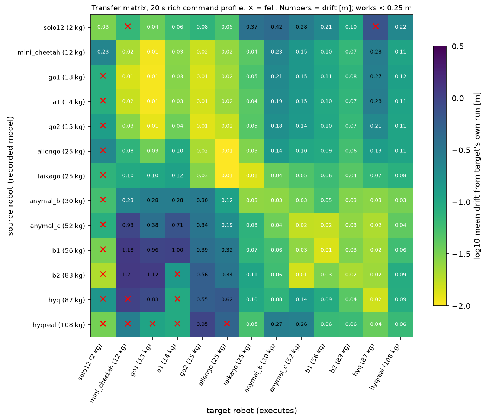<br>
  <em>All 169 source → target combinations on the 20 s rich command profile. ✕ = fell. Heavy-to-light (lower left) fails; light-to-heavy (upper right) mostly works.</em>
</p>

<p align="center">
  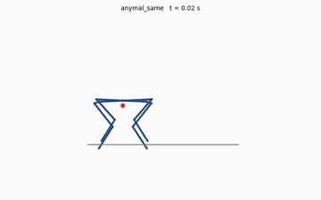 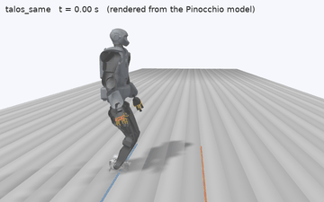<br>
  <em>Part A: same 1 m × 0.5 m jump, same 9.07 kg, 38 cm thigh, 33 cm shank: quadruped (left), humanoid legs (right).</em>
</p>

---

## Contents
1. [Part B: when does transfer work?](#part-b-when-does-transfer-work)
2. [Part B: every transfer (GIFs)](#part-b-every-transfer)
3. [Part B: robots and tables](#part-b-robots-and-tables)
4. [Part A: results](#part-a-results)
5. [Setup](#setup)
6. [Reproducing everything](#reproducing-everything)
7. [Part A: the maths of the jump](#part-a-the-maths-of-the-jump)
8. [Part B: the maths of the MPC transfer](#part-b-the-maths-of-the-mpc-transfer)
9. [Caveats and honest notes](#caveats-and-honest-notes)
10. [Repository layout](#repository-layout)
11. [Acknowledgements](#acknowledgements) · [Citation](#citation)

---

## Part B: when does transfer work?

### Experimental design

- **13 robots** (table [below](#part-b-robots-and-tables)): Go1, Go2, A1, Aliengo, Laikago, B1, B2 (Unitree), Mini Cheetah (MIT), ANYmal B and ANYmal C (ANYbotics), HyQ and HyQReal (IIT), and Solo-12 (ODRI). Seven of them were imported from `example-robot-data` with [`robot_import/urdf_to_gymquadruped.py`](mpc_transfer/robot_import/urdf_to_gymquadruped.py). All 13 complete the test profile under their own controller.
- **Rich command profile** (20 s): ramp up, cruise at 0.4 m/s, turn left, sidestep, faster turn right, stop. A constant straight-line command barely exercises the dynamics: in an earlier version of this study every robot tracked it.
- **Noise:** each joint gets Gaussian torque noise with σ = 4.4 % of its torque limit. That is exactly the original 2 N·m on Go1, and comparable across a 2.5 kg robot and a 108 kg one.
- **Outcome:** *drift* is the mean planar distance between the transferred run and the target's own native run on the same commands. Different noise seeds give a noise floor of 0.6–6 cm. We call a run **works** if it doesn't fall and drift is under 0.25 m, **degraded** if it doesn't fall but drifts more, and **fell** otherwise. The conclusions hold for thresholds from 0.15 to 0.4 m: inside the inertia envelope, 60/61 pairs work at 0.15 m and 61/61 at 0.4 m.
- **Experiments** (≈ 950 simulations, [`analysis/run_experiments.py`](analysis/run_experiments.py)):
  - the full 13 × 13 transfer matrix;
  - a **component ablation** for each of the 156 pairs, injecting only one of {base inertia, leg mass matrix, leg bias forces};
  - **controlled sweeps** on Go1 → Go1, scaling each injected quantity by 0.1×–16× (3 seeds each);
  - the original Jan-2025 Go1 recording replayed on all robots.

### 1. Which transferred quantity breaks it? Base inertia.

<p align="center">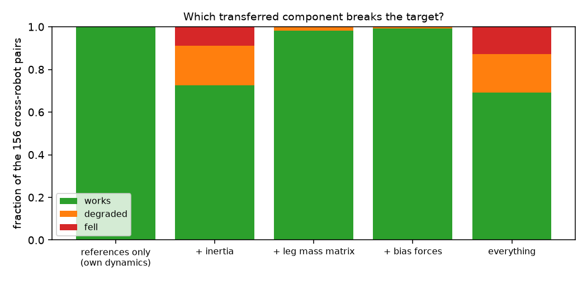</p>

| injected from the source robot (besides references) | works | degraded | fell | median drift |
|---|---|---|---|---|
| nothing (references only; target uses its own dynamics) | 156/156 | 0 | 0 | 0.015 m |
| **base inertia** | 113/156 | 29 | 14 | 0.055 m |
| leg mass matrices | 153/156 | 3 | 0 | 0.041 m |
| leg bias forces | 155/156 | 1 | 0 | 0.019 m |
| everything (full transfer) | 108/156 | 28 | 20 | 0.080 m |

<p align="center">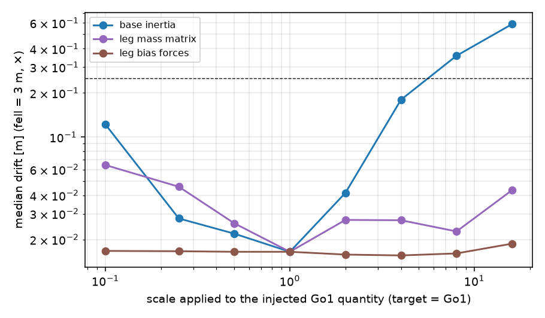</p>

The sweeps on Go1 (target = Go1, one injected quantity scaled) agree. Drift barely changes when the leg bias forces are scaled anywhere from 0.1× to 16×, or the leg mass matrix from 0.25× to 8× (it rises a little, to 0.04–0.06 m, at the extremes). Drift grows steadily with **overestimated** inertia: 0.04 m at 2×, 0.18 m at 4×, 0.36 m at 8× and 0.59 m at 16×. It grows much less with underestimated inertia: 0.12 m at 0.1×. In the swing controller, the leg terms only shape the feed-forward of a stiff Cartesian PD loop ($K_p = 5000$), which absorbs their errors. The base inertia, by contrast, sits inside the NMPC's prediction model, which plans the ground-reaction forces.

### 2. The operating envelope

<p align="center">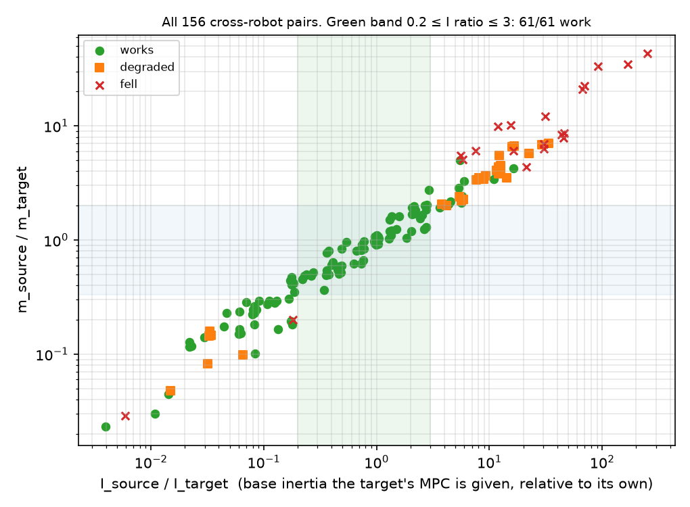</p>

| $I_\text{src}/I_\text{tgt}$ (geometric mean of the diagonal) | pairs | works | degraded | fell |
|---|---|---|---|---|
| [0, 0.1) | 30 | 23 | 6 | 1 |
| [0.1, 0.2) | 15 | 14 | 0 | 1 |
| [0.2, 0.5) | 20 | 20 | 0 | 0 |
| [0.5, 2) | 26 | 26 | 0 | 0 |
| [2, 3) | 15 | 15 | 0 | 0 |
| [3, 5) | 5 | 3 | 2 | 0 |
| [5, 10) | 15 | 5 | 7 | 3 |
| [10, inf) | 30 | 2 | 13 | 15 |

| $m_\text{src}/m_\text{tgt}$ | pairs | works | degraded | fell |
|---|---|---|---|---|
| [0, 0.1) | 7 | 3 | 3 | 1 |
| [0.1, 0.2) | 16 | 13 | 3 | 0 |
| [0.2, 0.5) | 28 | 27 | 0 | 1 |
| [0.5, 2) | 54 | 54 | 0 | 0 |
| [2, 3) | 12 | 7 | 5 | 0 |
| [3, 5) | 16 | 4 | 11 | 1 |
| [5, 10) | 16 | 0 | 6 | 10 |
| [10, inf) | 7 | 0 | 0 | 7 |

**Rule of thumb:** transfer works when the injected base inertia is within **0.2× to 3×** of the target's true inertia: 61/61 pairs inside work; outside, 47/95 work and 20 fall. For mass the range is **1/3× to 2×**: 66/66 pairs inside work; outside, 42/90 work and 20 fall. Because inertia scales roughly with mass across these robots (see the plot), the two conditions select nearly the same pairs.

*Why the asymmetry?* This is our interpretation, not something we isolated. The NMPC uses the target's own mass but the source's inertia, so it predicts the angular response to a moment as $I_\text{src}^{-1}\tau$. If $I_\text{src}$ is too large, the model thinks the body barely rotates and asks for large corrective moments, which over-rotate the real, lighter body. Under 100 Hz replanning that becomes oscillation and yaw drift, the behaviour visible in the HyQ/HyQReal GIFs. If $I_\text{src}$ is too small, the controller is merely timid, and replanning corrects the residual.

### 3. What predicts success, statistically

| pair feature | Spearman ρ with log drift | best single threshold (fails if …) | accuracy |
|---|---|---|---|
| inertia mismatch mean abs ln(I_src/I_tgt) | +0.78 | > 2.49 | 0.78 |
| leg mass-matrix mismatch | +0.84 | > 3.98 | 0.90 |
| leg bias-force mismatch | +0.71 | > 3.05 | 0.89 |
| abs ln(m_src/m_tgt) | +0.76 | > 1.61 | 0.79 |
| abs ln(hip-height ratio) | +0.65 | > 0.48 | 0.76 |
| abs ln(torque-limit ratio) | +0.67 | > 1.81 | 0.75 |
| same knee layout (1/0) | -0.23 | <= 0.00 | 0.69 |
| same manufacturer (1/0) | -0.29 | <= 0.00 | 0.69 |

The majority-class baseline is 0.69. A depth-2 decision tree on all features picks the leg mass-matrix mismatch and reaches 0.81 (folds 0.91, 0.77, 0.77, 0.71, 0.87) 5-fold CV accuracy:

```
|--- legM_mismatch <= 5.34
|   |--- legM_mismatch <= 0.90
|   |   |--- weights: [80.00, 2.00] class: 0.0
|   |--- legM_mismatch >  0.90
|   |   |--- weights: [28.00, 13.00] class: 0.0
|--- legM_mismatch >  5.34
|   |--- weights: [0.00, 33.00] class: 1.0
```

Leg-mass-matrix mismatch is the best *observational* predictor because it summarises overall size difference (limb masses × lengths²). The ablation shows it is **not causal**: inject it alone and 153 of 156 pairs still work. Correlation picks the best proxy for size; the ablation identifies the mechanism.

### 4. Families

| pairs | n | works | fell |
|---|---|---|---|
| same family | 46 | 38 | 1 |
| different family | 110 | 70 | 19 |
| within ANYbotics | 2 | 2 | 0 |
| within IIT | 2 | 2 | 0 |
| within Unitree | 42 | 34 | 1 |

Same-manufacturer pairs succeed more often only because they tend to be closer in size. Every within-Unitree failure is a B1 or B2 model (56–84 kg) on a 13–25 kg Unitree robot. Cross-family pairs of similar size work, for example Laikago ↔ ANYmal B, ANYmal C ↔ B1, and B2 ↔ HyQ.

### 5. Falls

All 20 falls: a1 → solo12, aliengo → solo12, anymal_b → solo12, anymal_c → solo12, b1 → solo12, b2 → a1, b2 → solo12, go1 → solo12, go2 → solo12, hyq → a1, hyq → mini_cheetah, hyq → solo12, hyqreal → a1, hyqreal → aliengo, hyqreal → go1, hyqreal → mini_cheetah, hyqreal → solo12, laikago → solo12, solo12 → hyq, solo12 → mini_cheetah. Eleven are on Solo-12, whose 2.7 N·m motors cannot follow any heavier robot's model on this profile. Solo-12 survives the gentler original Jan-2025 recording driven by Go1's model.

---

## Part B: every transfer

### Original Jan-2025 Go1 recording (human-driven, 40 s, shown at 2.5× speed) → every robot

| Go1 → Go1 | Go1 → quadDoggo (Go1 clone) | Go1 → Go1, masses ±20 %, base ×1.3 | Go1 → Solo-12 | Go1 → Mini Cheetah |
|---|---|---|---|---|
| <br><sub>xy err 0.03 m</sub> | 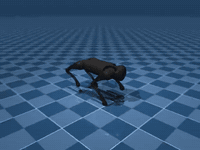<br><sub>xy err 0.03 m</sub> | 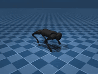<br><sub>xy err 0.16 m</sub> | 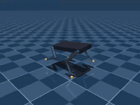<br><sub>xy err 0.10 m</sub> | 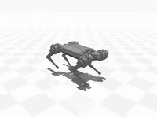<br><sub>xy err 0.31 m</sub> |
| **Go1 → A1** | **Go1 → Go2** | **Go1 → Aliengo** | **Go1 → Laikago** | **Go1 → ANYmal B** |
| 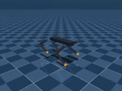<br><sub>xy err 0.37 m</sub> | 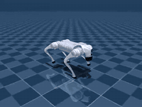<br><sub>xy err 0.05 m</sub> | 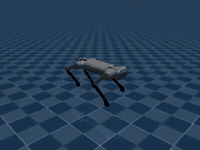<br><sub>xy err 0.08 m</sub> | 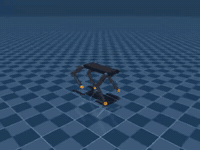<br><sub>xy err 0.13 m</sub> | 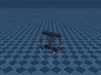<br><sub>xy err 0.07 m</sub> |
| **Go1 → ANYmal C** | **Go1 → B1** | **Go1 → B2** | **Go1 → HyQ** | **Go1 → HyQReal** |
| 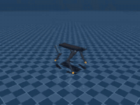<br><sub>xy err 0.19 m</sub> | 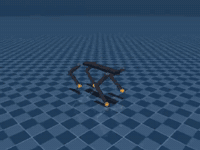<br><sub>xy err 0.41 m</sub> | 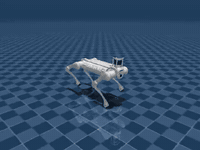<br><sub>xy err 0.28 m</sub> | 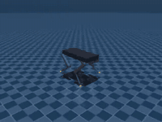<br><sub>xy err 1.22 m</sub> | 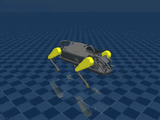<br><sub>xy err 1.14 m</sub> |

### Go1 model → every robot on the 20 s rich command profile (shown at 1.25× speed)

| Go1 → Solo-12 | Go1 → Mini Cheetah | Go1 → Go1 | Go1 → A1 | Go1 → Go2 |
|---|---|---|---|---|
| 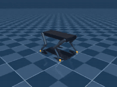<br><sub>**fell**</sub> | 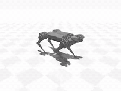<br><sub>drift 0.01 m (works)</sub> | 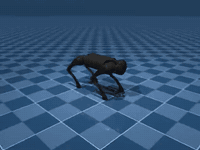<br><sub>drift 0.01 m (works)</sub> | 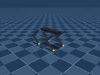<br><sub>drift 0.03 m (works)</sub> | 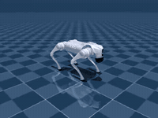<br><sub>drift 0.01 m (works)</sub> |
| **Go1 → Aliengo** | **Go1 → Laikago** | **Go1 → ANYmal B** | **Go1 → ANYmal C** | **Go1 → B1** |
| 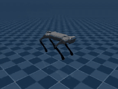<br><sub>drift 0.02 m (works)</sub> | 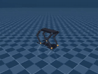<br><sub>drift 0.05 m (works)</sub> | 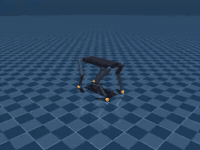<br><sub>drift 0.21 m (works)</sub> | 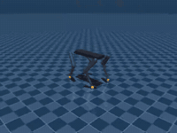<br><sub>drift 0.15 m (works)</sub> | 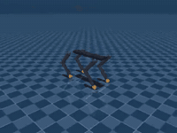<br><sub>drift 0.11 m (works)</sub> |
| **Go1 → B2** | **Go1 → HyQ** | **Go1 → HyQReal** |  |  |
| 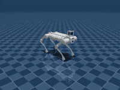<br><sub>drift 0.08 m (works)</sub> | 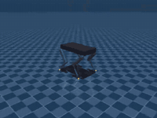<br><sub>drift 0.27 m (degraded)</sub> | 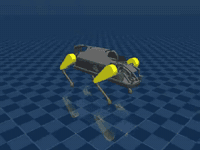<br><sub>drift 0.12 m (works)</sub> |  |  |

Every robot's native run, and every MP4 above at full length, is in [`media/videos/`](media/videos). Any other pair from the matrix can be rendered with `transfer.py --video` (see [Reproducing](#reproducing-everything)).

### Original screen recordings (January 2025)

These are the screen recordings made when the work was first done, using the interactive `simulation.py` (keyboard/joystick velocity commands). They are kept as-is.

| Go1 → Go1 | Go1 → Go1 (randomised dynamics) | Go1 → B2 | Go1 → HyQReal |
|---|---|---|---|
| 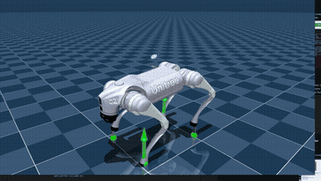 | 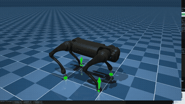 | 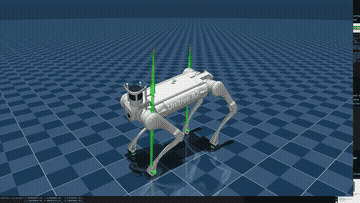 | 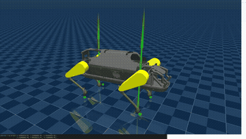 |

In January 2025 the slides listed Go1 → B2 and Go1 → HyQReal as failures. In the original recordings and in these reruns, that failure is large path error and heading drift, not a fall.

---

## Part B: robots and tables

#### Part B: the 13 robots, each under its own NMPC (20 s rich command profile)

| robot | family | mass [kg] | controller mass [kg] | hip height [m] | torque limit [N·m] | knees (front/rear) | I_xx, I_yy, I_zz [kg·m²] | own run | video |
|---|---|---|---|---|---|---|---|---|---|
| solo12 | ODRI | 2.5 | 2.5 | 0.23 | 3 | back/front | 0.03, 0.05, 0.07 | completes | [mp4](media/videos/native_solo12.mp4) |
| mini_cheetah | MIT | 12.5 | 12.5 | 0.23 | 31 | back/back | 0.15, 0.36, 0.40 | completes | [mp4](media/videos/native_mini_cheetah.mp4) |
| go1 | Unitree | 12.7 | 12.0 ⚠ | 0.30 | 45 | back/back | 0.15, 0.40, 0.42 | completes | [mp4](media/videos/native_go1.mp4) |
| a1 | Unitree | 13.7 | 13.7 | 0.27 | 34 | back/back | 0.15, 0.37, 0.39 | completes | [mp4](media/videos/native_a1.mp4) |
| go2 | Unitree | 15.2 | 24.0 ⚠ | 0.28 | 31 | back/back | 0.20, 0.51, 0.53 | completes | [mp4](media/videos/native_go2.mp4) |
| aliengo | Unitree | 24.6 | 24.0 | 0.35 | 38 | back/back | 0.26, 0.91, 0.92 | completes | [mp4](media/videos/native_aliengo.mp4) |
| laikago | Unitree | 25.4 | 25.4 | 0.40 | 43 | back/back | 0.45, 1.02, 1.04 | completes | [mp4](media/videos/native_laikago.mp4) |
| anymal_b | ANYbotics | 30.5 | 30.5 | 0.51 | 80 | back/front | 0.99, 2.01, 2.03 | completes | [mp4](media/videos/native_anymal_b.mp4) |
| anymal_c | ANYbotics | 52.1 | 52.1 | 0.56 | 80 | back/front | 1.75, 4.75, 4.68 | completes | [mp4](media/videos/native_anymal_c.mp4) |
| b1 | Unitree | 55.7 | 55.7 | 0.53 | 108 | back/back | 1.63, 5.24, 5.12 | completes | [mp4](media/videos/native_b1.mp4) |
| b2 | Unitree | 83.5 | 83.5 | 0.48 | 233 | back/back | 1.83, 7.17, 7.60 | completes | [mp4](media/videos/native_b2.mp4) |
| hyq | IIT | 86.8 | 86.8 | 0.60 | 150 | back/front | 4.19, 11.72, 12.69 | completes | [mp4](media/videos/native_hyq.mp4) |
| hyqreal | IIT | 107.6 | 108.4 | 0.50 | 210 | back/back | 4.76, 20.69, 21.32 | completes | [mp4](media/videos/native_hyqreal.mp4) |

#### Part B: the original Jan-2025 Go1 recording (human-driven, 40 s) replayed on every robot

| target | survived | mean abs x err [m] | mean abs y err [m] | mean abs z err [m] | Σ error (x+y+z) | video |
|---|---|---|---|---|---|---|
| quadDoggo | yes (40 s) | 0.011 | 0.021 | 0.003 | 710 | [mp4](media/videos/original_go1_to_quadDoggo.mp4) |
| go1 | yes (40 s) | 0.011 | 0.021 | 0.003 | 710 | [mp4](media/videos/original_go1_to_go1.mp4) |
| anymal_b | yes (40 s) | 0.036 | 0.036 | 0.010 | 1642 | [mp4](media/videos/original_go1_to_anymal_b.mp4) |
| aliengo | yes (40 s) | 0.015 | 0.068 | 0.003 | 1721 | [mp4](media/videos/original_go1_to_aliengo.mp4) |
| go2 | yes (40 s) | 0.037 | 0.017 | 0.044 | 1966 | [mp4](media/videos/original_go1_to_go2.mp4) |
| solo12 | yes (40 s) | 0.068 | 0.034 | 0.007 | 2189 | [mp4](media/videos/original_go1_to_solo12.mp4) |
| laikago | yes (40 s) | 0.070 | 0.058 | 0.005 | 2667 | [mp4](media/videos/original_go1_to_laikago.mp4) |
| go1_perturbed | yes (40 s) | 0.104 | 0.055 | 0.014 | 3457 | [mp4](media/videos/original_go1_to_go1_perturbed.mp4) |
| anymal_c | yes (40 s) | 0.071 | 0.117 | 0.011 | 3981 | [mp4](media/videos/original_go1_to_anymal_c.mp4) |
| b2 | yes (40 s) | 0.100 | 0.176 | 0.014 | 5812 | [mp4](media/videos/original_go1_to_b2.mp4) |
| mini_cheetah | yes (40 s) | 0.213 | 0.097 | 0.006 | 6322 | [mp4](media/videos/original_go1_to_mini_cheetah.mp4) |
| a1 | yes (40 s) | 0.243 | 0.131 | 0.002 | 7536 | [mp4](media/videos/original_go1_to_a1.mp4) |
| b1 | yes (40 s) | 0.220 | 0.194 | 0.007 | 8417 | [mp4](media/videos/original_go1_to_b1.mp4) |
| hyqreal | yes (40 s) | 0.542 | 0.593 | 0.012 | 22944 | [mp4](media/videos/original_go1_to_hyqreal.mp4) |
| hyq | yes (40 s) | 0.352 | 0.869 | 0.018 | 24806 | [mp4](media/videos/original_go1_to_hyq.mp4) |

*Error columns* (original recording): the mean absolute deviation per 2 ms step from the Go1 source's base path in x and y, and from the commanded height in z. The Σ column is the error $E$ defined [below](#what-transfer-means). ⚠ marks a controller mass that differs from the model mass by more than 5 %. This is upstream Go2 configuration, kept unchanged.

---

## Part A: results

#### Part A: jump (1 m forward, 0.5 m CoM rise)

| run | formulation | converged (iters) | mass [kg] | final base x [m] | peak abs τ [N·m] | Σ abs τ [N·m] | max abs τ / limit | pre-launch CoM margin [m] |
|---|---|---|---|---|---|---|---|---|
| `anymal` | inverse | True (40) | 52.13 | 1.011 | 396 | 17736 | 4.95 | +0.308 |
| `anymal_fwd` | forward | True (43) | 52.13 | 1.011 | 396 | 17736 | 4.95 | +0.308 |
| `anymal_same` | inverse | True (29) | 9.07 | 1.010 | 154 | 3722 | 1.92 | +0.266 |
| `b1` | inverse | True (10) | 55.69 | 1.015 | 427 | 21137 | 3.05 | +0.259 |
| `b1_same` | inverse | True (8) | 9.07 | 0.977 | 178 | 3547 | 2.22 | +0.286 |
| `go1` | inverse | True (9) | 13.10 | 1.035 | 178 | 3118 | 5.00 | +0.141 |
| `go1_same` | inverse | True (8) | 9.07 | 1.023 | 176 | 3597 | 2.20 | +0.131 |
| `hyq` | inverse | True (11) | 86.77 | 0.959 | 451 | 31808 | 3.01 | +0.267 |
| `hyq_same` | inverse | True (11) | 9.07 | 0.958 | 146 | 3752 | 1.82 | +0.279 |
| `talos` | inverse | True (74) | 90.27 | 0.914 | 1893 | 31848 | 6.31 | +0.008 |
| `talos_fwd` | forward | True (48) | 90.27 | 0.914 | 1893 | 31848 | 6.31 | +0.008 |
| `talos_same` | inverse | True (27) | 9.07 | 0.977 | 328 | 3491 | 4.10 | +0.008 |

Jump videos (stick-figure side view of the optimised trajectory):

| ANYmal | Talos legs | Go1 | B1 | HyQ |
|---|---|---|---|---|
| 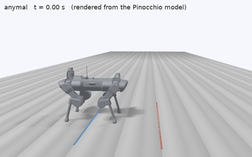 | 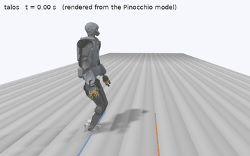 | 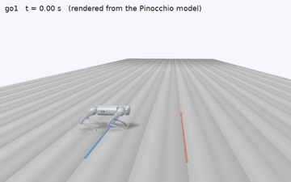 | 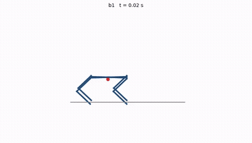 | 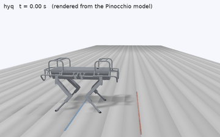 |

<p align="center">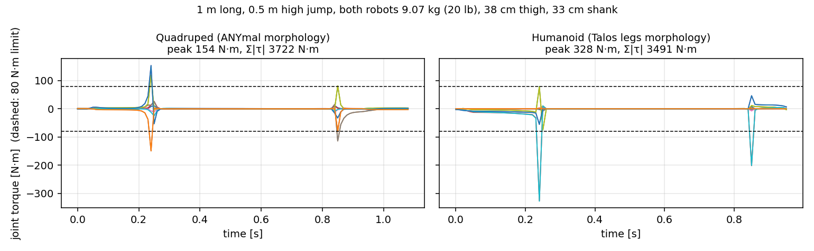</p>
<p align="center">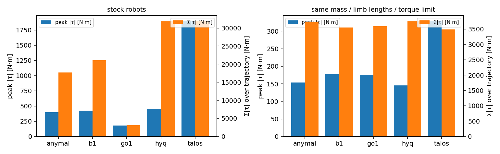</p>

---

## Setup

The two parts use separate environments: Crocoddyl's conda stack and acados' BLASFEO libraries conflict if you put them in one env.

### Part A: Pinocchio + Crocoddyl

```bash
conda env create -f environment/trajopt.yml        # pinocchio 3.4, crocoddyl 3.0.1, example-robot-data
conda activate xfer-trajopt
```

### Part B: MuJoCo + acados + Quadruped-PyMPC

```bash
bash environment/setup_mpc.sh    # ~10 min: builds acados, installs gym-quadruped, robot models and the vendored Quadruped-PyMPC
source deps/env.sh               # sets ACADOS_SOURCE_DIR, LD_LIBRARY_PATH, MUJOCO_GL=egl
```

`setup_mpc.sh` does the following, so you can do it by hand if you prefer:

1. Creates a conda env `xfer-mpc` (Python 3.11, `cmake<4`; the pinned acados predates CMake 4).
2. Clones **acados** at `03475431` (v0.4.3-16, the version used in Jan 2025), builds it with qpOASES, downloads the `t_renderer` code generator and `pip install -e`'s `acados_template`.
3. Installs the pinned Python packages in `environment/requirements-mpc.txt`. `adam-robotics` must be **0.3.0**; 0.5 breaks on URDFs without an inertial origin.
4. Clones **gym-quadruped** at `1b5b6c9` (2025-01-06), copies every model in `mpc_transfer/extra_robot_models/` into it (the 7 imported robots, quadDoggo, and URDF fixes) and installs it.
5. Installs the vendored, modified **Quadruped-PyMPC** in `mpc_transfer/Quadruped-PyMPC` (BSD-3, see its `LICENSE`).

The first NMPC call for each robot generates and compiles C code (~30 s). `XFER_CODEGEN_DIR` chooses where; `run_experiments.py` gives each parallel worker its own directory.

Tested on Ubuntu 24.04 (Linux 6.14), x86-64, 32 cores. No GPU is needed; rendering uses EGL (`MUJOCO_GL=osmesa` also works).

### Adding another quadruped

Any 12-DoF quadruped URDF with foot links works:

```bash
python mpc_transfer/robot_import/urdf_to_gymquadruped.py --urdf my_robot.urdf --srdf my_robot.srdf \
    --name my_robot --out mpc_transfer/extra_robot_models      # --effort N·m if the URDF limits are placeholders
cp -r mpc_transfer/extra_robot_models/my_robot deps/gym-quadruped/gym_quadruped/robot_model/
XFER_ROBOT=my_robot python mpc_transfer/Quadruped-PyMPC/simulation/transfer.py record --profile rich --steps 10000
```

The converter keeps the URDF's kinematics, masses, inertias, joint limits and effort limits exactly. It replaces meshes with capsules, a trunk box and foot spheres, so that only those touch the ground. It renames legs to the `FL/FR/RL/RR_{hip,thigh,calf}_joint` convention and takes the standing pose from the SRDF; without an SRDF it solves for one. It also writes `xfer_robot.json`, which `config.py` reads for any robot without a hand-written entry. `mpc_transfer/robot_import/import_robots.sh` regenerates the seven imported robots.

---

## Reproducing everything

```bash
# Part A: 12 trajectory optimisations (~2 min), torque plots, stick-figure videos
conda activate xfer-trajopt
bash trajopt/run_jumps.sh && (cd trajopt && python make_figures.py ../results/jump)

# Part B: ~950 simulations (~25 min on 32 cores) + analysis + tables
source deps/env.sh
bash mpc_transfer/run_transfers.sh                  # = analysis/run_experiments.py + analysis/analyze.py
python results/make_tables.py; python results/make_gif_grids.py
```

Single runs:

```bash
python trajopt/jump.py talos --same                 # humanoid, 9.07 kg / 38 cm / 33 cm / 80 N·m
python trajopt/jump.py anymal --fwddyn              # forward-dynamics transcription instead

cd mpc_transfer/Quadruped-PyMPC
XFER_ROBOT=hyq python simulation/transfer.py record   --profile rich --steps 10000 --noise-frac 0.044 --out /tmp/hyq.npz
XFER_ROBOT=go1 python simulation/transfer.py transfer --src /tmp/hyq.npz --steps 10000 --noise-frac 0.044 --video /tmp/hyq_to_go1.mp4
#  --parts ref,inertia            inject only some components      --scale-inertia 4   scale an injected quantity
#  --mass-scale 1.3 --seed 1      perturb the target's masses      --action-noise 2    absolute noise (original)
```

---

## Part A: the maths of the jump

### Dynamics

A legged robot with configuration $q \in SE(3)\times\mathbb{R}^{n_j}$, generalised velocity $v\in\mathbb{R}^{6+n_j}$, joint torques $\tau$ and contact forces $\lambda$ obeys

$$
M(q)\,\dot v + h(q,v) \;=\; S^\top \tau + J_c(q)^\top \lambda ,
\qquad S = \begin{bmatrix} 0_{n_j\times 6} & I_{n_j}\end{bmatrix},
$$

where $M$ is the joint-space inertia matrix, $h$ collects Coriolis, centrifugal and gravity terms, and $J_c$ stacks the Jacobians of the feet in contact. The first six rows (the floating base) are **unactuated**. They can only be moved through contact forces, which is what makes jumping hard.

### Inverse-dynamics direct transcription

Instead of integrating forward dynamics $\dot v = \mathrm{FD}(q,v,\tau,\lambda)$, we follow Ferrolho et al. (2021) and make accelerations and forces the decision variables. On a grid $t_k = k\,h$, $h = 10$ ms:

$$
\dot v^\*_k = \frac{v_{k+1}-v_k}{h}, \qquad
\tau^\*_k = f_{\mathrm{ID}}\!\left(q_k, v_k, \dot v^\*_k, \lambda_k\right) = \mathrm{RNEA}(q_k,v_k,\dot v^\*_k) - J_c^\top\lambda_k ,
$$

subject to the **underactuation constraint** (base rows of the RNEA residual equal zero) and

| constraint | expression |
|---|---|
| fixed initial standing state | $x_0 = x_{\text{stand}}$ |
| integration | $q_{k+1} = q_k \oplus h\,v_{k+1}$ (semi-implicit Euler on the manifold) |
| torque consistency | $\tau^\*_k - \tau_k = 0$ |
| no force without contact | $\lambda_{k,i} = 0$ if foot $i$ is in flight |
| contact feet do not move | $J_{c,i}\dot v + \dot J_{c,i} v = 0$ (stance), velocity reset at the landing impulse |
| friction cone (linearised, 4 facets, $\mu = 0.7$) | $\lVert\lambda_{xy}\rVert \le \mu\,\lambda_z,\; \lambda_z \ge 0$ |
| joint and velocity limits | $q_{\min}\le q\le q_{\max},\; \lvert v\rvert \le v_{\max}$ (as penalties) |

Inverse dynamics avoids factorising $M(q)$ inside the transcription and is reported to be better conditioned at coarse time steps. Here both formulations converge to the same trajectory: ANYmal took 40 iterations with inverse vs 43 with forward, Talos 74 vs 48 (see `*_fwd.json`).

### Cost

$$
\min_{x,u}\; \sum_{k} \Big( w_u\lVert u_k\rVert^2 + w_x\lVert x_k \ominus x_{\text{ref}}\rVert^2_{W}
+ w_c\lVert c(q_k) - c^{\text{des}}_k\rVert^2
+ w_\mu\,\lVert r_\mu(\lambda_k)\rVert^2
+ w_f\sum_{i\in\text{swing}}\lVert p_i(q_k)-p^{\text{des}}_{i,k}\rVert^2
+ w_b\,\lVert r_{\text{bounds}}(x_k)\rVert^2 \Big)
$$

with Crocoddyl's weights: $w_c = 10^6$ (CoM), $w_f = 10^6$ (swing foot; $10^7$ at landing), $w_\mu = 10$, $w_x = 10$, $w_u = 0.1$, $w_b = 10^3$.

### Phases

The horizon is split into five contact phases (25 ground knots and 30 flight knots, $h = 10$ ms):

| phase | contacts | what the solver must do |
|---|---|---|
| 1. Take-off | all feet | crouch, then push off |
| 2. Fly up | none | ballistic CoM, raise CoM to 0.5 m apex |
| 3. Fly down | none | reach the landing footholds 1 m ahead |
| 4. Landing | **impulse** | instantaneous velocity reset $M(v^+-v^-) = J_c^\top\Lambda$, $J_c v^+ = 0$ |
| 5. Landed | all feet | absorb, return to standing |

### Solver

Crocoddyl's `SolverIntro` handles the problem: a feasibility-driven DDP with nullspace-parametrised **equality constraints**, used for the underactuation and contact rows of the inverse-dynamics model. It does a Riccati backward pass on the linear-quadratic approximation, a nonlinear forward rollout and a line search. Pinocchio provides the analytical derivatives of RNEA, frame kinematics and the impulse dynamics. With `--fwddyn` the same problem is written with forward dynamics and solved with `SolverFDDP`, for comparison.

Robots come from `example-robot-data`: ANYmal C, Go1, B1, HyQ and Talos (legs only, via `buildReducedModel`). `--same` rescales a robot to 9.07 kg (20 lb), 38 cm thigh, 33 cm shank and an 80 N·m torque limit on every joint.

---

## Part B: the maths of the MPC transfer

### The controller: single-rigid-body NMPC (Quadruped-PyMPC)

The base is modelled as one rigid body of mass $m$ and inertia $I$ driven by the four ground-reaction forces $f_i$ applied at the feet $r_i$:

$$
\dot p = v,\qquad \dot v = \frac{1}{m}\sum_i f_i + g,\qquad
\dot\Theta = E(\Theta)^{-1}\omega,\qquad
I\dot\omega + \omega\times I\omega = \sum_i (r_i - p)\times f_i .
$$

At 100 Hz the controller solves over a 12-step, 0.24 s horizon:

$$
\min_{x,f}\sum_{k=0}^{N}\lVert x_k - x^{\text{ref}}_k\rVert_Q^2 + \lVert f_k\rVert_R^2
\quad\text{s.t. SRB dynamics},\;
\lvert f_{x,y}\rvert \le \mu f_z,\; f_z^{\min}\le f_z \le f_z^{\max},\;
f_i = 0 \text{ for swing legs}.
$$

$x^{\text{ref}}$ comes from the commanded base velocity. The gait is a trot (1.4 Hz, duty factor 0.65) with foothold optimisation. acados solves it as one SQP iteration per tick: Gauss-Newton Hessian, ERK integrator, partial-condensing HPIPM in "balance" mode.

The whole-body layer maps the result to joint torques:

$$
\tau_{\text{stance},i} = -J_i(q)^\top f_i,\qquad
\tau_{\text{swing},i} = J_i^\top\!\big(K_p e_p + K_d e_v\big) + M_i(q)\,J_i^{+}\big(\ddot p^{\text{des}}_i - \dot J_i\dot q\big) + h_i(q,\dot q),
$$

where $M_i$ and $h_i$ are the leg's block of the mass matrix and bias forces ($K_p = 5000$, $K_d = 100$). $I$ is recomputed each tick from MuJoCo's mass matrix at the current configuration.

### What "transfer" means

On the **source** robot we record, at every 2 ms step, the controller's model of itself:

$$
\mathcal{S}_k = \big(\,v^{\text{ref}}_k,\;\omega^{\text{ref}}_k,\;\{h_i\}_k,\;\{M_i\}_k,\;I_k,\;p^{\text{base}}_k\,\big).
$$

On the **target** robot we run the same controller, but replace its references, leg bias forces, leg mass matrices and base inertia with $\mathcal{S}_k$. The NMPC keeps the **target's own mass** $m$. The target's *kinematics* (foot positions, Jacobians, base state) are still measured from the target in MuJoCo. The controller therefore steers the target with the source's dynamics model.

Each joint gets Gaussian torque noise ($\sigma$ = 4.4 % of its limit; 2 N·m on Go1, as in the original experiment). For the original recording we report the tracking error against the source's base path,

$$
E = \sum_k \lvert x_k - x^{\text{src}}_k\rvert + \lvert y_k - y^{\text{src}}_k\rvert + \lvert z^{\text{ref}}_k - z_k\rvert ,
$$

per axis as a mean per step. For the matrix we report the drift from the target's own native run, $\frac{1}{K}\sum_k \lVert p^{xy}_k - p^{xy,\text{native}}_k\rVert$. This separates "the wrong model hurt" from "this robot simply walks the commands differently".

Mismatch measures, all computed from what each robot's controller actually used, averaged over its native run:
- inertia ratio: $\big(\prod_a I_{\text{src},aa}/I_{\text{tgt},aa}\big)^{1/3}$;
- inertia mismatch: $\tfrac13\sum_a \lvert\ln(I_{\text{src},aa}/I_{\text{tgt},aa})\rvert$;
- leg mass-matrix mismatch: $\lVert M_\text{src}-M_\text{tgt}\rVert_F/\lVert M_\text{tgt}\rVert_F$;
- bias mismatch: $\lVert h_\text{src}-h_\text{tgt}\rVert/\lVert h_\text{tgt}\rVert$.

---

## Caveats and honest notes

- **Part A was re-implemented.** The original Dec 2024 jump code could not be recovered, so `trajopt/jump.py` rebuilds the experiment from the slides with Crocoddyl's quadruped/biped jumping problems. The formulation, phases and constraints match the slides; the numbers are from this re-implementation.
- **Torque limits are not enforced in Part A.** Crocoddyl's jumping problem penalises state bounds but not actuator limits, so `max |τ| / limit` exceeds 1 for every robot. The results show *how much* torque each body needs for this jump, not that the jump is feasible on hardware.
- **Humanoid stability.** The slides argued that the humanoid's pre-launch CoM lies outside its support. In this re-implementation, with a 20 cm-long sole, it sits **8 mm inside** the support edge. That is marginal but not outside.
- **Imported robots are simplified.** The seven `example-robot-data` robots keep exact URDF kinematics, masses, inertias and limits. Their collision geometry is approximate (capsules and spheres). Joint damping, friction and armature are scaled from Go1's values, because URDFs don't carry them. Solo-12's URDF lists a placeholder 1000 N·m effort limit, so we use ODRI's ~2.7 N·m. Laikago has no SRDF, so its standing pose is solved for.
- **Bugs fixed relative to the Jan-2025 code:**
  - `quadDoggo` had no entry in the controller's tables and an Aliengo mass and hip height. It is a renamed copy of the Go1 model, so it now uses Go1's parameters, and its results match Go1's exactly (a useful sanity check).
  - Mini Cheetah's `qpos0_js` override rotated every thigh by 90°, because MuJoCo measures hinge angles relative to `qpos0`, and the robot fell after 0.1 s. Removing the override fixes it.
  - The IK helper and acados code-generation paths were hard-coded. They are now generic and parallel-safe.
- **Foot Jacobians in transfer.** The Jan 2025 code had a `feet_jacobians_new` path meant to replay Go1's Jacobians. Because `mj_jac` overwrote the buffers immediately afterwards, the target's own Jacobians were used in practice. `transfer.py` does this explicitly. The original patch is kept in `mpc_transfer/patches/` for reference.
- **Upstream configuration quirks kept as-is.** Go2's controller mass is 24 kg against a 15.2 kg model, and B2's config inertia is copied from another robot (unused, since inertia is recomputed). Mass is never transferred, so this affects every Go2 run equally.
- **Single seed per pair** in the matrix and ablation (the sweeps use 3). Self-transfer drift with a different seed is 0.6–6 cm, well below the 25 cm threshold.
- **One controller.** All conclusions are about a single-rigid-body NMPC with a stiff swing-leg PD. A whole-body MPC that uses the full mass matrix in its prediction model may be far more sensitive to leg dynamics.

---

## Repository layout

```
trajopt/
  jump.py                 Part A: jump trajectory optimisation (Pinocchio + Crocoddyl)
  run_jumps.sh, make_figures.py
mpc_transfer/
  Quadruped-PyMPC/        vendored IIT-DLS Quadruped-PyMPC (BSD-3) with the transfer changes
    simulation/transfer.py              headless record / transfer driver (Part B)
    simulation/simulation_original_jan2025.py   original interactive script
  robot_import/           URDF -> gym-quadruped converter + script that imports 7 robots from example-robot-data
  extra_robot_models/     the imported robots, quadDoggo, and URDF fixes for Go1 / Mini Cheetah / ANYmal
  patches/                Jan-2025 change to gym-quadruped (feet Jacobian logging/replay)
  convert_original_recording.py   original .pkl recording -> .npz
  run_transfers.sh        all Part B runs + analysis
analysis/
  run_experiments.py      parallel runner: native, matrix, ablation, sweep, original
  analyze.py              features, envelope, ablation, sweeps, decision tree, figures
data/                     the original Jan-2025 Go1 recording
results/                  per-run JSON (+ 50 Hz trajectories), analysis/ (figures, summary.json), jump/, table generators
media/                    videos (mp4) and GIFs
environment/              conda/pip specs and setup script
CITATION.bib
```

---

## Acknowledgements

This project is built on, and would not exist without:

- **[MuJoCo](https://mujoco.org/)** (Todorov et al.): physics simulation for Part B.
- **[Pinocchio](https://github.com/stack-of-tasks/pinocchio)** (Carpentier et al.) and **[Crocoddyl](https://github.com/loco-3d/crocoddyl)** (Mastalli et al.): rigid-body dynamics, analytical derivatives and the DDP solvers for Part A.
- **[Quadruped-PyMPC](https://github.com/iit-DLSLab/Quadruped-PyMPC)** and **[gym-quadruped](https://github.com/iit-DLSLab/gym-quadruped)** (Turrisi et al., IIT Dynamic Legged Systems Lab): the NMPC and MuJoCo environment that Part B modifies. The vendored copy keeps its BSD-3 license.
- **[acados](https://github.com/acados/acados)** (Verschueren et al.) with HPIPM/BLASFEO: the NMPC solver.
- **[example-robot-data](https://github.com/Gepetto/example-robot-data)**: robot models for Part A and the seven imported quadrupeds. The robots themselves are from Unitree, ANYbotics, IIT, MIT and the Open Dynamic Robot Initiative.
- Ferrolho et al. (ICRA 2021), for the inverse-dynamics transcription.

---

## Citation

If you find this useful, you can cite it as a blog post:

```bibtex
@misc{anaxolotl2026leggedxfer,
  author       = {Fay, Kehlani},  % TODO: full name as you want it cited
  title        = {Legged Cross-Embodiment Transfer with {MPC}: When Does a Controller Carry Over Between Robots?},
  year         = {2026},
  howpublished = {Blog post / code repository, \url{https://github.com/An-Axolotl/legged-cross-embodiment-transfer-mpc}},
  note         = {Original work Dec 2024 -- Jan 2025; 13-robot analysis 2026}
}
```

Please also cite the tools above. Their BibTeX entries are in [`CITATION.bib`](CITATION.bib).

## License

The code in `trajopt/`, `analysis/`, `mpc_transfer/*.py|*.sh`, `mpc_transfer/robot_import/`, `results/` and `environment/` is BSD-3-Clause (see `LICENSE`). `mpc_transfer/Quadruped-PyMPC/` keeps its upstream BSD-3 license. Robot models keep the licenses of their sources.
